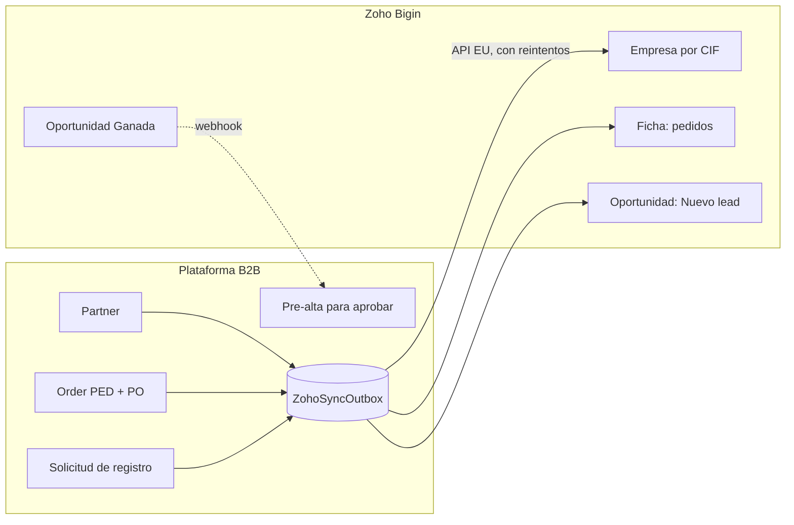

# Conexión del CRM (Zoho) con la Plataforma B2B

Diseño técnico de las funcionalidades 20, 21 y 22 de [`funcionalidades.md`](funcionalidades.md). **Sin implementar** a 2026-10-05.

## Principio

La plataforma es la fuente de verdad del cliente activo y empuja sus datos al CRM. El CRM solo devuelve una señal, la oportunidad ganada, y nunca crea una empresa activa por su cuenta.



| Quién manda | En qué |
|---|---|
| Plataforma | Razón social, CIF, direcciones, marca de catálogo, tipo (distribuidor o partner), estado, tarifa, descuento, pedidos |
| CRM | Comercial responsable, fase, próxima acción, potencial, origen, observaciones |

Los campos de la plataforma se ven en Zoho como solo lectura (por convención; Bigin no bloquea campos por origen). Los del CRM no se copian a la plataforma.

## Datos que viajan

| Dato | Origen | Llega a | Cuándo | Funcionalidad |
|---|---|---|---|---|
| Razón social, CIF, país, dirección, teléfonos | `Partner` | Empresa en Zoho, alta o actualización por CIF | Alta, edición, aprobación | 20 |
| Marca de catálogo, tipo, estado | `Partner.marcaCatalogo`, `tipo`, `estado` | Campos de solo lectura en Empresa | Al cambiar | 20 |
| Correos de contacto y facturación | `Partner.correoContacto1/2`, `correoFacturacion` | Contacto vinculado a la empresa | Alta y edición | 20 |
| Pedido: código PED, PO, fecha, total neto, estado, tracking | `Order` | Bigin: nota por pedido y resumen en la empresa (último pedido, nº y importe de 12 meses). Zoho CRM: pedido de venta | Confirmación y cada cambio de estado | 20 |
| Solicitud de registro con email verificado | `Partner` en `PENDIENTE_APROBACION` | Oportunidad en Nuevo lead, origen «Portal B2B», país de la empresa | Al verificar el email | 20 |
| Oportunidad ganada de una empresa nueva | Zoho | Pre-alta en el panel de admin | Webhook al pasar a Ganado | 21 |
| Distribuidor sin pedidos en 60 días | Plataforma | Tarea de seguimiento para el propietario de la empresa en Zoho | Revisión nocturna | 22 |

**Nunca sale:** usuarios de la plataforma, contraseñas, tokens, precios del catálogo por empresa (`RepresentacionPartner`). `descuentoPorcentaje` solo si se decide que los agentes lo vean (pendiente).

### Campos de integración en Zoho (Empresa)

ID plataforma (UUID), CIF, Marca de catálogo, Tipo de empresa, Estado en plataforma, Fecha último pedido, Pedidos 12 meses, Importe 12 meses (€).

## Cambios en el backend

Módulo nuevo `backend/src/integraciones/zoho/`:

| Pieza | Qué hace |
|---|---|
| `zoho-auth.service.ts` | OAuth de servidor (Self Client): cambia el refresh token por access token y lo cachea en Redis hasta que caduca |
| `zoho-api.adapter.ts` | Interfaz común con dos implementaciones: Bigin (`/bigin/v2`, módulos Companies, Contacts, Pipelines) y Zoho CRM (`/crm/v8`, Accounts, Contacts, Deals). Cambiar de producto solo toca esta pieza |
| `zoho-sync.service.ts` | Convierte `Partner` y `Order` en registros de Zoho y hace alta o actualización por CIF (upsert) |
| `zoho-outbox.worker.ts` | Vacía `ZohoSyncOutbox` con reintentos y espera creciente; marca errores definitivos para revisar |
| `zoho-webhook.controller.ts` | `POST /integraciones/zoho/webhook` para la funcionalidad 21 |
| `zoho-inactivos.job.ts` | Revisión nocturna de la funcionalidad 22 |

Hoy el backend no tiene cola ni tareas programadas: el worker y el job necesitan `@nestjs/schedule` o una cola sobre el Redis que ya existe (`common/redis`).

### Base de datos (migración Prisma)

- `Partner.zohoId String?` y `Order.zohoId String?`: id del registro en Zoho, para actualizar sin buscar.
- Tabla `ZohoSyncOutbox`: `id` (UUID v4), `entidad` (PARTNER, ORDER, REGISTRO), `entidadId`, `operacion`, `estado` (PENDIENTE, ENVIADO, ERROR), `intentos`, `ultimoError`, `createdAt`, `procesadoEn`.
- Pre-alta (funcionalidad 21): un `Partner` nuevo en `PENDIENTE_APROBACION` con `creadoPor` vacío y origen CRM, o una tabla aparte de solicitudes. Decidir al implementar; en ningún caso queda `ACTIVO` sin aprobación del admin.

### Dónde se escribe en el outbox

Siempre **dentro de la transacción que ya existe**, para que un fallo de Zoho nunca bloquee ni deshaga nada en la plataforma:

| Evento | Método actual |
|---|---|
| Pedido confirmado | `PedidosService.confirmar()` (`$transaction`) |
| Cambio de estado del pedido | `PedidosService.actualizarEstado()` |
| Alta y edición de empresa | `PartnersService.crear()`, `actualizar()`, `suspender()`, `reactivar()`, `promocionar()`, `degradar()`, `archivar()` |
| Registro verificado | `AuthService.verificarEmail()` |
| Alta aprobada o rechazada | `AuthService.aprobarPartner()`, `rechazarPartner()` |

### Carga inicial

Script en `backend/scripts/` que recorre todas las empresas (hoy 13 distribuidores y 3 partners) y su histórico de pedidos y los mete en el outbox. Se puede repetir sin duplicar, porque todo es upsert por CIF y por código PED.

## Webhook de oportunidad ganada

1. En Zoho: automatización «al pasar a Ganado» con un webhook `POST` a `/integraciones/zoho/webhook` que envía el id de la oportunidad y un secreto compartido.
2. La plataforma comprueba el secreto (comparación en tiempo constante), aplica límite de peticiones y **no se fía del contenido**: vuelve a leer la oportunidad y su empresa por la API para confirmar que existe y está en Ganado.
3. Si la empresa ya existe en la plataforma (por CIF o `zohoId`), no hace nada más que registrar el evento. Si no, crea la pre-alta pendiente de aprobar y avisa a los administradores por correo (Amazon SES, ver [`correos.md`](correos.md)).
4. Todo queda en `AuditLog` (`eventType` `ZOHO_WEBHOOK`), sin guardar el secreto.

## Configuración

Variables nuevas en `backend/.env` (solo en el servidor, nunca en el repo ni en chats):

```
ZOHO_ACTIVO=false                     # interruptor general; apagado = no se escribe en el outbox
ZOHO_PRODUCTO=bigin                   # bigin | crm
ZOHO_ACCOUNTS_URL=https://accounts.zoho.eu
ZOHO_API_URL=https://www.zohoapis.eu
ZOHO_CLIENT_ID=...
ZOHO_CLIENT_SECRET=...
ZOHO_REFRESH_TOKEN=...
ZOHO_WEBHOOK_SECRET=...
ZOHO_DIAS_INACTIVIDAD=60
```

Permisos (scopes) del Self Client, solo los necesarios: módulos (lectura y escritura), ajustes (lectura) y usuarios (lectura). Con Bigin, `ZohoBigin.modules.ALL`, `ZohoBigin.settings.READ`, `ZohoBigin.users.READ`; con Zoho CRM, los equivalentes `ZohoCRM.*`.

## Límites

- Créditos de API en ventana móvil de 24 h ([documentación de Bigin](https://www.bigin.com/developer/docs/apis/v2/api-limits.html)): Gratuito 5.000; Express, Premier y Zoho One 50.000 + 250 por usuario, con máximo de 100.000. Cada llamada cuesta 1 crédito; insertar o actualizar cuesta 1 por cada 10 registros (máximo 100 por llamada); leer registros con `cvid` cuesta 3; la escritura masiva cuesta 500 al iniciarse. La sincronización gastará unos cientos al día, así que sobra margen incluso en el plan gratuito.
- Concurrencia: 5 llamadas simultáneas por usuario en Gratuito y 10 en Express, Premier y Zoho One. El worker del outbox debe procesar en serie o con pocas llamadas en paralelo.
- Webhooks salientes: en planes de pago (Express y superiores).
- Centro de datos: la cuenta debe estar en `.eu`; las URLs de arriba cambian si no.

## Seguridad

- Se mantienen las reglas de [`CLAUDE.md`](../../CLAUDE.md): UUID v4 en tablas nuevas, auditoría en JSON, 404 opaco. El endpoint del webhook no expone datos y responde igual ante cualquier error.
- Credenciales de Zoho solo en variables de entorno, con los permisos mínimos.
- Datos personales de contactos en el centro de datos europeo de Zoho y con acuerdo de tratamiento de datos (RGPD) firmado.

## Requisitos para empezar a programar

- [ ] Cuenta confirmada (Bigin o Zoho CRM) y en `.eu`
- [ ] Self Client creado en `api-console.zoho.eu` y refresh token guardado como secreto del entorno
- [ ] Red del entorno de nube con `accounts.zoho.eu` y `www.zohoapis.eu` permitidos (hoy el proxy los bloquea)
- [ ] Decidido si los agentes ven importes y descuento
- [ ] Campos de integración creados en Zoho (ver arriba)

## Fases

1. **Decidir** (reunión comercial) y **CRM solo** (piloto, sin código). Pasa cuando el piloto usa el CRM a diario y la vista «Sin próxima acción» está vacía varias semanas.
2. **Plataforma → CRM** (funcionalidad 20 y carga inicial). Pasa cuando las empresas cuadran por CIF y un pedido de prueba aparece en su ficha con el estado correcto.
3. **CRM → Plataforma** (funcionalidad 21) y **clientes inactivos** (22). Pasa cuando una oportunidad ganada de prueba genera la pre-alta y queda en la auditoría.
4. Opcional: pasar a Zoho CRM si hacen falta territorios o pedidos de venta, o Zoho Analytics para un panel único de pipeline y ventas reales.
